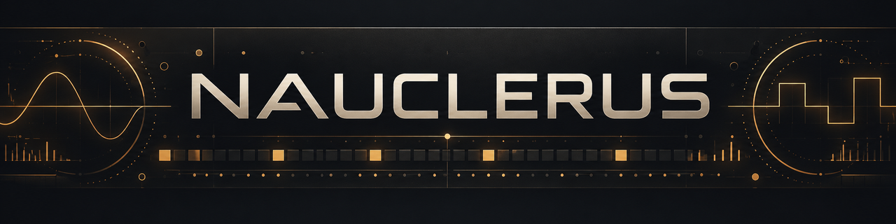
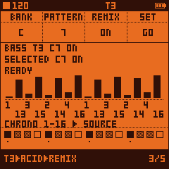

# Nauclerus

[GitHub repository](https://github.com/Mr-Roboto/nauclerus) · [Releases/downloads](https://github.com/Mr-Roboto/nauclerus/releases)

**[Live simulator](https://mr-roboto.github.io/nauclerus/#play)** ·
**[Interactive manual](https://mr-roboto.github.io/nauclerus/#manual)** ·
**[Install Nauclerus](https://mr-roboto.github.io/nauclerus/webapp/installer/)**



The simulator runs the release's actual firmware. Installation is a separate explicit
WebMIDI action and is enabled only after verifying the exact stable package SHA-256.

[](LICENSE)

**Groovebox firmware for the M-VAVE FM-1.** Eight tracks of drums and up to two ACID bass voices,
64-step patterns, ORB Remix, TB-3PO generation, Grids, Motion, parameter locks and per-track LFOs.
Nauclerus development, modifications and remix work by **Mr. Roboto**, based on **Hortator by DEADACTIVE**,
built on **[Felucca](https://github.com/hugelton/Felucca) by Leo Kuroshita / Hügelton Instruments**.

**Hardware update (2026-10-28):** The owner reports successful installation of the published 0.25.0 firmware over RC13 on a physical FM-1; the device restarted and the new firmware runs. Physical rollback remains untested. See [identity migration](docs/IDENTITY_MIGRATION_0.25.0.md).

**Nauclerus 0.25.0** promotes the accepted RC13 implementation without DSP changes; it also corrects menu-header redraw and modal-input defects. It includes magnitude-only unipolar routing, project compatibility, and the
Graphite/Champagne/Amber web portal. The owner accepts the remaining subjective ACID
resonance/filter-character limitation. See the [release validation record](docs/RELEASE_VALIDATION_0.25.0.md).

- **[User guide](docs/USER_GUIDE.md):** current page layouts, button combinations and recording/storage behavior.
- **[0.25.0 release notes](docs/RELEASE_NOTES_0.25.0.md)** and **[release readiness](docs/RELEASE_READINESS_0.25.0.md)**.
- Upstream Hortator browser/installer links and historical phase documents describe upstream or earlier
  implementations. They are not a published Nauclerus 0.25.0 installer or a substitute for its release package.

On a Roman galley, the *hortator* beat the drum that kept the rowers in time. Nauclerus preserves that
Hortator/Felucca ancestry; all original contributor and license notices remain below.

The [panel/navigation guide](docs/USER_GUIDE.md#panel-navigation) describes the accepted controls.
The legacy panel photograph is not included in release staging: its redistribution permission is unverified,
and it is not presented as a screenshot of 0.25.0. No historical UI mockup is advertised as a stable screenshot.

## What it does

- **Eight drum tracks.** Each plays a drum model: 808 and 909 kicks, snares and claps, hats, toms, cowbell, cymbal,
  rim, clave, conga, ports of Plaits' drum algorithms, and samples. Every model has TUNE, DECAY, TONE and a fourth
  knob of its own.
- **Step sequencer.** Up to 64 steps per track on the 16 white keys, each track with its own length, division and
  swing. Accents, PROB and RATCH per step, fills that play every other bar, live recording, mutes that wait for the
  next bar (the MUTE screen: hold GLO).
- **Notes and ACID.** Every step holds a note. Drum tracks play their steps transposed (C4 plays as tuned); ACID, a
  303-style bass voice (TUNE DECAY CUTOF RESO ENVMD ACCNT WAVE GATE: SAW, variable-width PULSE or MORPH into a resonant 24 dB filter, with
  accent, slide and tie), plays them as a bass line on up to two tracks ("ACID: 2 TRACKS MAX"). SCL turns the keys
  into a keyboard for the selected track (KEYS): play it, record it live, or enter a line step by step. Live record:
  on TRACKS a REC tap arms / disarms the selected track (`T3 REC ARMED` / `T3 REC OFF`); on every other screen a REC
  tap is REC ALL, to finger-drum a whole kit live: every track armed (`REC ALL`), each white track key plays and records
  its own track wherever the keys play tracks (HOME, SOUND, FX, TRACKS ...), while KEYS, step record and knob motion
  stay the selected track's; a REC tap there again ends it, the tracks armed before it armed again (`T3 REC ARMED`, or
  `REC OFF` when none was). REC never starts the transport: PLAY does, and an armed track records once playing. A key
  writes the nearest step, a key held into later steps writes TIEs, a legato overlap writes a SLIDE (TIE and SLIDE on
  ACID tracks only). An ACID
  track's STEP page is a piano roll; a step the white keys turn on takes the last KEYS note on an ACID track, C4 on a
  drum. KEYS notes send no MIDI out, and an ACID note (or a tied chain) longer than 5.5 s
  is cut (a safety limit). A loaded project keeps ACID on its first two ACID tracks; the others come back as their
  power-on kit drum.
- **ORB Remix.** 256 owner-created mappings, A1–P16, with neutral A1. One shared GLOBAL DRUM selection and
  independent Bass selections per physical ACID track. K1/K2 draft, K4 SET or OCT+ confirm; K3 ON/OFF needs
  no confirmation. Playback changes at chronological step boundaries; notes, Motion and locks follow the
  source while recording stays chronological. Song rows use their project slot's configurations.
- **TB-3PO.** The actual X0X-RMX v1.1.0 melody core, 22 scales, seeded phrases and restrained mutation.
  ARP on ACID opens GENERATE/SCALE; OCT+ NEW and OCT− MUTATE work with KEYS or ENV/STEPS enabled.
  Settings/seeds are independent per physical track and saved with projects. Automatic mutation counts
  completed pattern loops, not necessarily 4/4 bars.
- **ACID PWM and MORPH.** FASTSLOW is the first ACID preset: TUNE −12, DECAY50, CUTOF80, RESO30,
  ENVMD60, ACCNT64, PULSE, GATE40; new untouched track LEVEL104 (−4dB), width64. MORPH controls
  5–95% pulse width, or Sharkfin/Trapezoid/Notch-Trapezoid. SAW disables its editor without losing the value.
  One MORPH voice at a time; SAW/PULSE remain available independently on both ACID tracks.
- **MOTION.** Knob turns recorded per step while a track plays, and played back with the pattern: up to 1024 events
  per project (shared by the 8 tracks).
- **SONG and names.** Chain up to 16 rows of projects with repeats; name projects on the device.
- **Grids.** Mutable Instruments' pattern generator: a map of drum patterns, chaos, or Euclidean rhythms. Any track
  can follow one of its three channels. On GRIDS page 2, K4 clockwise assigns T1–T3 to kick/snare/hat.
  Stopped, OCT+ on either GRIDS page writes a deterministic two-bar rhythm to eligible drum tracks,
  sets LEN64/DIV1/32/SRC STEP and enables ordinary Remix playback of the resulting steps.
- **Compressor.** The Streams compressor keyed by any track, for ducking and pumping; GHOST keeps the pump with the
  key track muted.
- **Movement.** Two LFOs per track, ten wave shapes, three rate modes and four independent SRC/DEST/DEPTH slots.
  Each slot selects L1BI/L2BI (existing bipolar), L1U+/L2U+ (positive-only) or L1U-/L2U- (negative-only).
  UNI modes use unsigned 0–100% DEPTH; the mode alone sets direction. Legacy negative UNI values retain their absolute magnitude without phase reversal.
  A.MOR routes either/both LFOs to ACID pulse width or oscillator morph, with the manual value as base.
  Stored source 0/1 and all defaults remain exact BIP; 2–5 add modes without changing project size or IDs.
- **Effects.** DIST, the SLICER and RESON (string, pipe or chord resonator) per track; delay, ROOM or SPRING reverb
  and chorus sends; a master limiter; SPEAKER EQ with BASS+ for the small speaker. RESON is tuned in semitones (TUNE);
  its **KEYF** (KEYFOLLOW, RESON 2/2 KNOB 4, 0 % = off) makes the ring follow the note of each hit from C4: at 100 % a
  step at C5 (or a KEYS note, a ratchet's note) rings an octave above TUNE, at 50 % half an octave; MIDI notes play
  their track at C4, so they ring at TUNE. A new note under a ringing tail glides to it in a few ms, without a click.
- **PERFORM.** Hold FX: the black keys play live master effects (repeat, reverse, tape stop, filters, freeze,
  octave), the white keys mute tracks while held, the knobs become FILTER / CRUSH / THROW / DEPTH, which stay on
  until you turn them back.
- **Metronome.** GLOBAL 3/3 METRO: a click on every quarter note while playing, the bar's first higher.
- **Key backlight.** MENU BACKLIGHT DIM LO / DIM HI: the keys and buttons glow dimly while unlit, the steps 1, 5, 9
  and 13 a little brighter; INV turns the LEDs around. OCT- / OCT+ breathe when pressing them would do something.
- **MIDI LEARN.** Up to 32 controls of any controller: a CC moves one knob of one track, a CC or a note presses PLAY,
  REC, next / previous track, or holds a PERFORM effect ([below](#midi-learn)).
- **Connections.** MIDI in over USB and the TRS jack, MIDI clock in (USB or TRS), and USB audio: the FM-1 records
  into a DAW over its USB cable. On a computer or an iPad it shows up as **Nauclerus** (USB MIDI and audio, in a DAW
  or AUM; earlier versions: Felucca); while an update is being written it shows up as **Felucca Update**
  (the update loader, upstream Felucca's). The Bluetooth version adds Bluetooth MIDI ([below](#bluetooth-midi)): a BLE-MIDI
  keyboard or clock, or the M-VAVE SMC-Mixer as a mixer for the eight tracks.
- **Projects.** Four slots, A to D, saved in the FM-1's flash; the last one saved loads at power-on.

### On the panel

| Button | Opens |
| --- | --- |
| **HOME** | short: HOME/TRACKS behavior; from MENU/normal overlays, cancel to real HOME. Long: Settings. Within Settings, short cycles GLOBAL → SYSTEM → GLOBAL; long exits to real HOME. |
| **EDIT** | the selected track's sound: its model and knobs (on HOME, EDIT, FX and LFO the selected track's key is lit; a white key F3..F4 selects its track) |
| **SEQ** | the steps on the white keys (a short tap: on / off, on the release; hold a step 0.3 s: an off step turns on at once, an on step stays as it is; while held KNOB 1 / 2 / 3: PROB / RATCH / ACCENT (right on, left off); hold OCT+ and tap a step: its accent; OCT+ alone / OCT-: the bank), then PATTERN, REMIX, MOTION and SONG |
| **FX** | FX, SLICER, RESON, delay, reverb and chorus; hold it for PERFORM |
| **ARP** | Selected drum: GRIDS (2 pages); selected ACID: TB-3PO GENERATE/SCALE. |
| **LFO** | the track's two LFOs, side by side on every page (LFO 1 on KNOB 1-2, LFO 2 on KNOB 3-4), then DEST: 4 slots, each a source (LFO 1 / LFO 2), a destination knob and its own depth |
| **REC** | on TRACKS: arms / disarms the selected track for recording (`T3 REC ARMED` / `T3 REC OFF`; during REC ALL: REC ALL ends, the selected track armed). On every other screen: REC ALL on / off (every track armed, each white key records its own track; off: the arm state from before back). It never starts play: PLAY does. On STEP with KEYS on and stopped: step record. Held on a SEQ page: CLEAR TRACK; on SONG: DELETE ROW / CLEAR SONG |
| **GLO** | short: system MENU open/close; held: MUTE overlay ([mutes](#mutes); G4: [MIDI LEARN](#midi-learn)). |
| **SAVE** | PROJECT and TOOLS. On PROJECT: K3/OCT− LOAD, K4/OCT+ SAVE; existing two-activation safeguards remain. |
| **SCL** (labelled SEL in the web simulator) | Outside MENU, KEYS: the keys play the selected track; OCT- / OCT+ set the octave (-2 to +2); on STEP, stopped, REC starts step record  In MENU: alternative ENTER for dedicated submenus only; SELECT encoder still navigates. |
| **ENV** | STEPS / TRACKS (and [parameter locks](#parameter-locks)) (a tap, on its release; its LED lit and a padlock in the top bar, left of the battery, in STEPS). **STEPS**: the white keys are the selected track's steps on every page (HOME, EDIT, FX, LFO, COMP, TRACKS armed ...), tapped and held as on SEQ; hold ENV and press OCT+ / OCT- for the next / previous bank; OCT+ held + a step: its accent; OCT+ alone and OCT- keep their page's job (LAYER, back to SOUND, the LFO's RATE MODE). Finger drumming needs TRACKS (ENV off: the keys as before). ENV turns KEYS off, SCL turns STEPS off. Off at power-on |

On the two ACID TB-3PO pages, an ordinary OCT+ / OCT− is NEW / MUTATE regardless of KEYS or ENV/STEPS;
held-step editing, ENV-held banking and modal actions retain priority. Elsewhere, with KEYS on, OCT- / OCT+ are the octave: LAYER (from EDIT) and the LFO pages' OCT+ (the RATE MODE of the LFO turned
last) need KEYS off; the STEP
bank stays on KNOB 1; TRACKS keeps OCT as its bank. TRACKS, COMP, NAME, the menu, PERFORM (FX held) and the MUTE
screen (GLO held) keep their keys.
Step record starts in KEYS mode, on the STEP page, with the transport stopped, by a REC tap: the cursor starts at the
bank's first step and the top bar shows `STEP REC nn`. KNOB 1 to 4 are STEP, NOTE, TIME (NOTE / TIE / REST) and FLAG
(- / ACC / SLD / A+S); EDIT writes a rest. A REC tap, PLAY or leaving the page ends it.

ALGORITHM picks the track anywhere. SELECT turns the pages of a section and moves the menu's cursor; on HOME's
TRACKS mode it sets the tempo instead (`CLK USB` / `CLK TRS` when following a clock; GLOBAL 1/3 KNOB 1 sets it on any
page). KNOB 1 to 4 edit what the screen shows. PRESETS loads the next / previous preset onto the selected track at
each detent (a popup shows the bank and the presets around it); EDIT held opens the PRESETS list (LOAD, SAVE into the
USER bank, DELETE). The SOUND pages show the track's preset, with `*` once a SOUND knob moved.

### Mutes

Hold GLO: the **MUTE screen**, up while GLO is held (a quick GLO tap opens MENU instead; a key pressed while GLO
is down opens the screen at once). The eight tracks are boxes, **filled = heard, outline = muted**, each with its
number and model, and under it the key that toggles it (F3 to F4, the white keys; their LEDs lit for the heard
tracks). The top C# sets `MUTE: NOW`, the top D# `MUTE: NEXT BAR` (the same setting as GLOBAL 3/3 MUTE): with NEXT
BAR, a mute made while playing blinks, then lands on the next downbeat. G4 (the next white key up) turns
[MIDI LEARN](#midi-learn) on and off. While the screen is up the keys play nothing and the knobs and the other
buttons rest, PLAY aside. Let go of GLO: back to the page you were on.

### MIDI LEARN

A controller's knobs, faders, buttons and pads can each be learned: up to 32 of them.

| Learn | How to pick it (LEARN on) | What it takes | What it does |
| --- | --- | --- | --- |
| a knob of a track | turn the knob (it edits as usual) | a CC | moves that knob of that track, 0..127 over its range |
| PLAY | press PLAY (nothing plays) | a CC or a note | a press = a PLAY tap: play / stop (on SONG: the song) |
| REC | press REC (nothing arms) | a CC or a note | a press = a REC tap, as the button: TRACKS the selected track, elsewhere REC ALL (step record as the button) |
| NEXT TRACK / PREV TRACK | turn ALGORITHM right / left (the track stays) | a CC or a note | a press selects the next / previous track |
| a PERFORM effect | hold FX, press its black key (nothing plays) | a CC or a note | held while the controller's button is held, as the key (FX need not be held) |
| a track's PERFORM mute | hold FX, press its white key F3..F4 | a CC or a note | the track silent while held |
| a PERFORM macro | on the PERFORM screen, turn KNOB 1..4 (it turns as usual) | a CC | FILTER (0 at 64: left LPF, right HPF), CRUSH, THROW, DEPTH; stays on, as the knob |

- **Turn it on:** hold GLO (the MUTE screen) and press **G4**: `G4 LEARN: ON`, and `MIDI LEARN ON` in the top bar.
  Let go of GLO: the footer's first row (where the steps are) shows `LEARN: TURN OR PRESS`.
- **Pick a knob:** turn a knob of the selected track on any page: HOME, EDIT (SOUND, LAYER), FX (FILTER, the sends,
  SLICER, RESON), LFO, PATTERN, or LEVEL / LEN / PAN on HOME's TRACKS mode. It edits as usual and the footer says
  `T3 DECAY: SEND A CC`.
- **Or pick an action:** while LEARN is on, PLAY, REC, ALGORITHM and the PERFORM keys pick their action instead of
  doing their job (they work again after OCT+): the footer says `PLAY: SEND CC/NOTE`, `FX R1/16: SEND CC/NOTE`,
  `FX MUTE T3: SEND CC/NOTE`; a PERFORM knob `FX FILTER: SEND A CC`.
- **Move the controller's knob, or press its button or pad:** the first CC (or, for an action, note) that arrives
  (any channel; over USB, the TRS jack, or Bluetooth in MIDI mode) is learned: `CC74 -> T3 DECAY`,
  `NOTE36 -> PLAY`, `CC20 -> FX FILTER`. Then pick the next one. One already learned shows `T3 DECAY = CC74` or
  `PLAY = NOTE36`; sending another replaces it.
- **The binding is to that track:** CC74 moves track 3's DECAY whichever track is selected later.
- **One control, one thing:** learning a CC or note again moves it to the new pick; learning a pick again replaces
  its CC or note. `LEARN FULL` after 32. CC 0 and 32 (bank select) and 120 to 127 (channel mode) are never learned
  (`CC NOT LEARNABLE`). MODEL and RESON's MODEL can't be learned (`NOT LEARNABLE`).
- **While LEARN is on, OCT- and OCT+ are its own:** OCT- clears the pick's CC or note (`T3 DECAY CC CLEARED`,
  `PLAY CLEARED`); with nothing picked it asks `CLEAR ALL LEARNED?` (OCT+ yes, OCT- no). **OCT+ ends LEARN**
  (`LEARN DONE`), as GLO + G4 does. So pick the page first (LAYER, the step bank, a DEST slot), then turn LEARN on. The
  menu, a confirm, or NAME also end it; it is always off at power-on.
- **What a CC does on a knob:** 0 to 127 spans the knob's whole range; a centred knob (PAN, an LFO's DEPTH, FILTER
  ENV) is 0 at 64; a list (FILTER TYPE, DIV, WAVE) steps through it in its order. A model's knob follows the track's
  model (a model without that knob ignores it). An LFO on the same knob keeps moving it around the new value. During
  a song, PATTERN's knobs stay as they are. CC moves are not recorded as motion.
- **A button:** a CC of 64 or more is a press, under 64 a release (only the change counts: a knob swept past 64
  presses once); a note on is a press, its note off (or velocity 0) the release. A learned note plays no drum. A
  PERFORM effect held this way follows the keys' rules (the last pressed buffer effect plays) and ends with the
  release, or when the menu, a confirm, NAME or the MUTE screen comes up (press again after).
- Learned CCs and notes act whether LEARN is on or off, on every input but Bluetooth in SMC DAW mode (the
  SMC-Mixer's layout keeps its own controls). PLAY, REC and the track buttons act where the FM-1's own would (not in
  the menu or a confirm). They are saved in the FM-1's flash (not in projects) after each change, when stopped; the
  16 CCs of the first MIDI LEARN load as they were.

### PERFORM

Hold FX for the PERFORM screen. The black keys are buffer effects while held (REPEAT 1/8 1/16 1/32, REVERSE, TAPE
STOP, LPF and HPF sweeps, FREEZE, OCT UP / DN), the white keys silence their tracks while held, and KNOB 1 to 4 are
FILTER (left LPF, right HPF), CRUSH, THROW and DEPTH: while the PERFORM screen is up the knobs are only these, and
SELECT turns no page under it. **The knob effects stay on** after FX is let go (or the PERFORM
page closes) and keep working on every page; the top bar shows an amber `FX` in place of the tempo icon while any
is on. To switch one off, turn it back to 0 on the PERFORM screen; TOOLS `INIT*` switches them all off. The
buffer effects stop when their key is let go.

### Projects

Current FDRF records remain 3840 bytes. In addition to the existing sounds, patterns and banks, reserved
metadata stores global Drum/per-track Bass Remix and TB-3PO settings/seeds; ACID MORPH/PWM is retained
per track. Legacy/invalid extensions default safely without regenerating old steps. Song uses per-slot
steps, timing, Motion/locks, Remix, generator settings and ACID wave/MORPH; it does not switch an entire
sound kit. See [Projects and Song](docs/USER_GUIDE.md#projects-and-song).

SAVE > PROJECT: four slots, A to D. **The last project saved loads at power-on** (`LOADED` in the top bar, stopped;
PROJECT's SLOT points at it). If it can't be loaded (the slot is empty or unreadable), the FM-1 asks
`LOAD FAILED: SLOT B` / `START NEW PROJECT?`: OCT+ (YES) forgets it, OCT- (NO) tries it again at the next power-on;
both carry on with the power-on kit. A safe start (SEQ held at power-on) loads nothing.

Projects saved by this build can't be read by 0.16.0 or older; older projects load (every track with PRIO HIGH).
Since the parameter locks, a project's motion lives in its own lock bank beside it: projects saved now show
an empty slot on 0.23.x and older (`LOAD FAILED` at power-on; downgrading is safe, not supported: nothing breaks, the projects stay for this
build); every older project loads with its motion. If a project's lock bank can't be read (an upload to USR3 under
upstream Felucca overwrote it), the project still loads, without its motion, and the FM-1 says `LOCKS LOST` once.

**User sample slot 3 (USR3) holds up to 48 KiB** (USR1 and USR2: 80 KiB, as before): the rest of its flash holds the
projects' lock banks. A longer USR3 (uploaded under upstream Felucca) is shortened to its first 48 KiB once, at the
next power-on (`USR3 SHORTENED TO 48K`); it keeps playing, minus what was past 48 KiB. Nauclerus does not add a sample-upload workflow:
an 80 KiB upload to USR3 under upstream Felucca afterwards overwrites the lock banks.

### Parameter locks

In STEPS (ENV lit), on any page whose knobs MOTION can record (HOME's macros, TRACKS' LEVEL and PAN, SOUND, LAYER,
FX, SLICER, RESON, FILTER, the LFOs' RATE MORPH DEPTH, the DEST slots' DEPTH), **hold a step and turn a knob**: that
step plays with its own value for that knob, and the next step plays the knob's value again (the LFO, if any,
modulates round the locked value). The top bar says `LOCK STEP 5` while a step is held, and the knob cells show that
step's values (a locked one inverted). Knobs MOTION can't record (MODEL, FILTER TYPE, RESON MODEL, an LFO's WAVE,
DEST, SRC) do nothing while a step is held. Hold the step and tap OCT- to clear its locks on this page's knobs
(`STEP 5 LOCKS CLEARED`); hold OCT- 0.6 s to clear all of that step's locks (`STEP 5 ALL CLEARED`). A step turned off
keeps its locks for when it is on again. Locks and recorded MOTION share 1024 events per project (`LOCKS FULL`); locks
always play (MOTION's PLAY and CLEAR are for recorded motion only). On SEQ STEP a held step keeps PROB / RATCH / ACC.
In STEPS the footer's step strip underlines each locked step of the bank; SEQ > MOTION shows the selected track's
MOTION (recorded events) and LOCKS counts.

### Metronome

GLOBAL 3/3 **METRO**: OFF, LOW, MID, HIGH. While playing, on the FM-1's own clock or following one, a click on every
quarter note, higher on the bar's first. It comes after the PERFORM effects (they leave it alone) and follows the
MASTER volume, on the speaker, the headphones and USB audio. A device setting: saved, not part of projects.

### Screen colours

GLO short > MENU > COLOR: **ORANGE** (default), **ORANGE INV**, **BLUE**, **BLUE INV**,
**WHITE**, **WHITE INV**, **YELLOW**, **YELLOW INV**, **VIOLET**, **VIOLET INV**, **RED**, **RED INV**.
K1 steps back/forward; OCT+ advances; selection wraps. ORANGE has #E96F25 background and #321308 ink;
ORANGE INV is #160904 background with #F48532 ink. RED is #D80000/white; RED INV reverses it.
See the [guide palette table](docs/USER_GUIDE.md#color-themes) for all pairs and stored indices.
Preferences and default ID remain compatible: historical GREEN/GREEN INV slots are WHITE variants,
and stored IDs0/1 now show Orange. Color is device-wide and saves when MENU closes.

### Knob acceleration

MENU (GLO short) **ACCEL** (ON by default): a knob turned on in one direction over a wide value (more than 32
steps) speeds up with how fast it turns. A click at a time, or a turn of up to about 12 clicks a second, is one step
a click (fine control); faster, the steps grow with the speed, in fractions of a step: about x2 at 20 clicks a
second, x4 at 40, up to x8 (x4 on a value of 64 steps or less). A 0..127 value takes about 65 clicks at 20 a second,
34 at 40, 24 at 60 (upstream Felucca's: 127, 65, 64). The first clicks of a turn and the first click back after a
reversal are one step. Lists of names (MODEL, TYPE, WAVE ..) are one entry a click at any speed; the PRESETS list at
most x4. ACCEL OFF: one step a click at any speed.

### Key backlight

MENU (GLO short) **BACKLIGHT** (the LED levels of upstream Felucca's MENU > LEDS): OFF (lit or dark, as before),
DIM LO, DIM HI, INV, INV LO, INV HI. DIM LO (an older Hortator's BACKLIGHT ON): every key LED that is not lit and every
idle button glows at about 5 %, so the panel can be found in the dark; on every screen where the white keys are the
selected track's steps (STEP, PATTERN, MOTION and SONG while KEYS is off; HOME's TRACKS mode while no track is armed),
the unlit steps 1, 5, 9 and 13 of the bank shown glow at about 25 % (bank 2: 17, 21, 25, 29), marking the beats. DIM
HI: the same, brighter (about 10 %, the beats about 30 %). INV turns it around as the stock firmware does: the idle
LEDs lit, the active ones (steps that are on, the playhead, held keys, the page's button) dark; INV LO / INV HI the
same with the idle ones at about 10 % / 25 %. In every mode OCT- / OCT+ **breathe** (fade in and out, upstream
Felucca's) where pressing them would do something: the next / previous bank on the steps, LAYER from SOUND, the LFO pages' RATE MODE (OCT+),
YES in a dialog, OK in the menu, NAME's RENAME, MIDI LEARN's DONE, the PRESETS list's LOAD (and DELETE on a used user slot); a
way back (NO, CANCEL, BACK, LAYER's OCT-) is lit; KEYS' octave shift lit as before. KNOB 1 on the row steps through the
levels, OCT+ steps on and wraps. A device setting: saved when the menu closes, not part of projects; OFF until it is
set. A safe start keeps every LED dark, as before.

### CPU and PRIO

When an audio block takes more than 95 % of its time, the FM-1 stops one sounding voice to catch up, and the top bar
shows a red CPU icon for 2 s. A track with **PRIO LOW** loses its voices before a PRIO HIGH one, the oldest first;
a held ACID note goes last. The same order picks the voice to stop when too many play at once. PRIO is on the track's last EDIT (SOUND) page, after CHOKE: HIGH by default, saved in the project.

## Bluetooth MIDI

The following describes the inherited **Hortator + Bluetooth MIDI** variant (experimental).
The default Nauclerus acceptance/package does not establish a separate Nauclerus BLE release.
These controls apply only to a separately built BLE variant, not the default package.
Bluetooth is **off at every power-on**, unless you set AUTOSTART ON (below); it runs only after you turn it on, until
the FM-1 is switched off.

BLE MIDI implementation credit: **DEADACTIVE**; preserve this attribution when reusing that code.

### The Bluetooth page

MENU (GLO short), SELECT to **BLUETOOTH**, OCT+. SELECT moves the cursor, KNOB 1 changes the row, OCT+ acts on it,
OCT- goes back to the menu.

| Row | What it does |
| --- | --- |
| **BLUETOOTH** | ON starts Bluetooth and reconnects to the remembered device; OFF disconnects and stops reconnecting. KNOB 1 right / left, or OCT+. Not saved: off at every power-on (unless AUTOSTART is ON). |
| **AUTOSTART** | ON: Bluetooth starts by itself 5 s after every power-on, as if you chose BLUETOOTH ON, and reconnects to the remembered device. KNOB 1 right / left, or OCT+. Saved when the menu closes; OFF by default. Not in a safe start (SEQ held). If the last Bluetooth start before this power-on did not finish (a hang or a crash in it) or ended in an error, it is skipped and the top bar says `BT AUTOSTART SKIPPED`; BLUETOOTH ON by hand still works. |
| **MODE** | What the connected device's MIDI does: **AUTO** (SMC DAW for a device whose name starts with `SMC`, else MIDI), **SMC DAW** or **MIDI**. Saved when the menu closes. |
| **DEVICE** | The remembered device: its name once it has been seen since power-on, else its address; `NONE`. KNOB 1 left forgets it (and disconnects). |
| **SCAN** | OCT+: scans for 10 s (BLUETOOTH ON only). Up to 8 devices are listed under it, BLE-MIDI ones (`MIDI`) first, then by signal. |
| **1 .. 8** | A device found: OCT+ remembers it (saved at once) and connects to it. |

Above the rows, the state: OFF, STARTING, IDLE, SCANNING, CONNECTING, CONNECTED and the device's name, or FAILED and
the reason (`NO RF TRIM IN FLASH`: this FM-1 cannot run Bluetooth; `BT START TIMEOUT`: switch off and on to retry).
Under it, the last error (`CONNECT TIMEOUT`, `NO BLE-MIDI SERVICE`, `DISCONNECTED 0x08`). `BT CONNECTED` and
`BT LOST` show in the top bar on any page.

**Reconnecting.** With BLUETOOTH ON and a remembered device, the FM-1 connects to it whenever it is in range: when
it is switched on again or comes back after a lost connection, and after a power-on as soon as you turn BLUETOOTH
ON, or 5 s after it with AUTOSTART ON (no scan or pick needed). While it is not found, it scans 10 s at a time with a
2 s pause. A SCAN from the page pauses this while the page stays open, so you can pick another device.

**MIDI mode.** Notes on the drum channel (GLO: CH) play the tracks whose NOTE matches, as over USB and TRS. GLO:
**CLK BLE** follows the device's MIDI clock (Start, Stop and the tempo), as CLK USB / TRS do; the tempo knobs then say
`CLK BLE`. A project saved with CLK BLE loads with CLK INT in the plain version.

### The SMC-Mixer (DAW mode)

The M-VAVE SMC-Mixer in its DAW (Mackie Control) mode, MODE AUTO or SMC DAW. Only presses act.

| Control | Nauclerus BLE variant (inherited) |
| --- | --- |
| Fader 1–8 | track 1–8 LEVEL, with pickup (below); recorded as motion for the selected track while it is armed and playing |
| Master fader | nothing |
| Knob 1–4 | the selected track's first four knobs (TUNE DECAY TONE and the model's fourth; ACID: TUNE DECAY CUTOF RESO), one step a click; the top bar shows e.g. `T3 DECAY 64`; recorded as motion while the track is armed and playing |
| Knob 5–8 | nothing |
| MUTE 1–8 | mute / unmute the track, as its key on the MUTE screen (MUTE: NEXT BAR applies) |
| SOLO 1–8 | solo / unsolo the track (below) |
| REC 1–8 | arm / disarm the track for recording (as a REC tap: no play started). During REC ALL: REC ALL ends and that track is disarmed, the others stay armed |
| SELECT 1–8 | select the track |
| PLAY | stopped: play; playing: nothing |
| STOP | stop |
| REC | as the FM-1's REC tap: on TRACKS arm / disarm the selected track, elsewhere REC ALL on / off |
| BANK ◀ / CHANNEL ◀, BANK ▶ / CHANNEL ▶ | the previous / next track (stops at 1 and 8) |
| REW, FF, the arrows | nothing |

While a song plays or is armed, REC 1–8 and REC say `STOP TO EDIT`, as the FM-1's REC does. An armed track records the
FM-1's keys as live record does.

- **LEDs:** MUTE n lit = track n muted (or a mute waiting for the next bar), SOLO n = soloed, REC n = armed,
  SELECT n = the selected track, PLAY = playing, STOP = stopped, REC = any track armed. They are sent again on every
  connection.
- **Fader pickup:** a fader does nothing until it reaches its track's level (within 2, or passing it); until then
  the mixer blinks its LED. Then it follows. On every connection, and whenever a track's LEVEL changes some other
  way (the FM-1's knob, LOAD, INIT, LEVEL motion), that fader has to be picked up again.
- **Solo:** while any track is soloed, only the soloed tracks are heard; several can be soloed. A silenced track
  is dimmed on HOME and TRACKS, as a muted one; the mutes are unchanged. The FM-1 has no SOLO control, so solo
  clears by itself when the SMC-Mixer disconnects and when MODE leaves SMC DAW (every track audible again; nothing
  is cut). Solo is not saved: INIT and a power-on clear it too.
- **Leaving SMC DAW** (MODE MIDI while connected): Nauclerus's inherited BLE code turns the mixer's LEDs off once and sends it nothing
  more.

## Install

Stable package: [nauclerus-0.25.0.fwsc](https://github.com/Mr-Roboto/nauclerus/releases/download/v0.25.0/nauclerus-0.25.0.fwsc).

```text
SHA-256 b496e081fd78c05eaa3cd368caf384285ec7b708477c5ff638f373e6a3c2a870
```

It identifies as **Nauclerus 0.25.0**, using application/package identity **FM-1_25000**, the existing
USB VID/PID and **Felucca Update** loader. Download the matching
source archive and licenses from [release v0.25.0](https://github.com/Mr-Roboto/nauclerus/releases/tag/v0.25.0).

Use only the exact package approved for your installation and its matching instructions/checksum;
keep a known-good recovery path available. Existing installer/recovery tools are in this tree,
and the [Nauclerus installer](https://mr-roboto.github.io/nauclerus/webapp/installer/)
verifies the stable package before enabling installation. Use the updated tools for
RC13 migration or rollback; legacy port names remain supported. Upstream Hortator
installers distribute their own firmware. See [release readiness](docs/RELEASE_READINESS_0.25.0.md)
and [recovery notes](docs/RECOVERY.md).

### Back to the official firmware

Use M-VAVE's updater, M-UPGRADE, from <https://www.m-vave.com/download> (Downloads → PC Software → M-UPGRADE), with
the appropriate official FM-1 firmware; consult [the recovery notes](docs/RECOVERY.md) before relying on that path. If the FM-1 stops answering both the installer and M-UPGRADE, a Mac
can put the official firmware back through the chip's boot mode, with no extra hardware: [docs/RECOVERY.md](docs/RECOVERY.md).
If it does not start at all and never reaches boot mode, recovering it needs a
[Transporter](https://github.com/kurogedelic/FM-1-transporter).

## Build

- The firmware and its package: [BUILDING.md](BUILDING.md) (`./build.sh`; `DRUM_PACKAGE=1 ./build.sh` for an
  installable package; website preparation is independent).
- The web simulator and the landing page: [docs/SIMULATOR.md](docs/SIMULATOR.md) (`tools/build_sim.sh`; build it
  independently of device packaging; preview installation is disabled until a verified
  package is explicitly staged).
- Tests: `tests/run_tests.sh` and `tests/run_drum_tests.sh` (firmware), `tools/build_sim.sh` (simulator and site).
- Version/tool background: [docs/VERSIONING.md](docs/VERSIONING.md). For this release, follow the
  [current 0.25.0 readiness record](docs/RELEASE_READINESS_0.25.0.md); publishing tools are inherited
  and do not themselves authorize a stable release or establish a Nauclerus hosted installer.

## Layout

| Path | What |
| --- | --- |
| `firmware/` | firmware sources: `src/` app, `hal/` hardware layer, `loader/` update loader |
| `tools/` | build scripts, generators, package maker, installer, publishing |
| `assets/` | icon atlas, font, CC0 samples |
| `web/` | web installer and editor; `web/sim/` the landing page and simulator |
| `tests/` | tests that run on the build machine; `tests/sim_*` the simulator's |
| `docs/` | device install notes, versioning, the simulator, design specs and plans |

## Credits

- **Nauclerus by Mr. Roboto:** development, modifications, integration and remix work; credited on-device in ABOUT.
- **X0X-RMX v1.1.0**, pinned at `a4e78f3a6e16fa310b7614e5876d07e16a0020f9`: TB-3PO musical core,
  canonical ORB mapping import and mathematical reference for the fixed-point MORPH family.
  TB-3PO retains its schwung-tb3po / Phazerville Hemisphere Suite / djphazer and contributors lineage.
- **ORB-inspired pattern data creation:** Mr. Roboto, who explicitly declares independent creation and
  authorizes redistribution in Nauclerus. Future Retro Orb is conceptual inspiration, not copied pattern data.
  The [current declaration](assets/remix/README.md#attribution-record) supersedes the older transcription account;
  the pinned source/compiled-table chain is verified and existing GPL notices remain.
- [Hortator](https://github.com/DeadActive/hortator) by DEADACTIVE. BLE MIDI: 2026 DEADACTIVE.
- [Felucca](https://github.com/hugelton/Felucca) by Leo Kuroshita ([@kurogedelic](https://github.com/kurogedelic)),
  [Hügelton Instruments](https://hugelton.com): the firmware Hortator is built on, its hardware layer, update
  loader, installer, UI and engines.
- [Grids](https://github.com/pichenettes/eurorack/tree/master/grids) by Emilie Gillet, Mutable Instruments: the GRIDS
  pattern engine is a C port (GPL-3.0-or-later).
- [Streams](https://github.com/pichenettes/eurorack/tree/master/streams) by Emilie Gillet, Mutable Instruments: the
  compressor is a C port (MIT).
- [Plaits](https://github.com/pichenettes/eurorack/tree/master/plaits) by Emilie Gillet, Mutable Instruments: integer
  ports of its drum algorithms and stmlib (MIT).
- [DaisySP](https://github.com/daisyaudio/DaisySP) by Electrosmith and Emilie Gillet: the modal resonator and
  membrane of the SKIN engine and the RESON effect are fixed-point ports (MIT).
- Pixel font and VU logo: drawn by DEADACTIVE.
- Font: [Terminus](https://terminus-font.sourceforge.net/) by Dimitar Toshkov Zhekov,
  [SIL OFL 1.1](assets/fonts/Terminus-LICENSE.txt).
- Samples: [Versilian Studios](https://versilian-studios.com/) VSCO-2 Community Edition and VCSL, CC0 1.0
  ([attribution](assets/samples-cc0/ATTRIBUTION.txt)); the Hügelton Sample Pack (CC0 1.0 under the independently verified rights-holder grant; see [LICENSING.md](LICENSING.md)).
- Web editor icons: Fukiai by Hügelton Instruments, [MIT](web/FUKIAI-LICENSE.txt).
- Package format and boot files: [JieLi AC79 SDK](https://gitee.com/Jieli-Tech/fw-AC79_AIoT_SDK) (Apache-2.0, not
  included).
- Recovery tool: [jl-uboot-tool](https://github.com/kagaimiq/jl-uboot-tool) by Andrey Grigoryev (kagaimiq), MIT.
- Boot screen study: UnifrakturMaguntia and UnifrakturCook by j. 'mach' wust and Peter Wiegel, SIL OFL 1.1.
- Research: the MD voices were measured from Joe Landers' Machinedrum emulator, a fork of
  [Gearmulator](https://github.com/dsp56300/gearmulator) by The Usual Suspects (the DSP56300 project); measurements
  only, no code or data from it. Machinedrum is a trademark of Elektron. Hortator is not affiliated with Elektron,
  Joe Landers or The Usual Suspects.

## Licence

Code: [GPL-3.0-only](LICENSE). Assets and third-party material: [LICENSING.md](LICENSING.md).

M-VAVE and FM-1 are trademarks of their respective owners. Nauclerus and Hortator are independent firmware that runs on FM-1
hardware; it is not affiliated with, endorsed by or supported by them. The plain version never enables the
hardware's Bluetooth / Wi-Fi radio; the Bluetooth version turns on Bluetooth only when you set BLUETOOTH ON (or
AUTOSTART ON: then 5 s after each power-on).

Copyright (C) 2026 Leo Kuroshita (@kurogedelic), Hügelton Instruments; drum machine fork: 2026 DEADACTIVE; BLE MIDI:
2026 DEADACTIVE.

Nauclerus development, modifications and remix work: Mr. Roboto (2026). Original notices and third-party licenses remain in force.

Identity migration and compatibility: [NAU-0250-015](docs/IDENTITY_MIGRATION_0.25.0.md).
